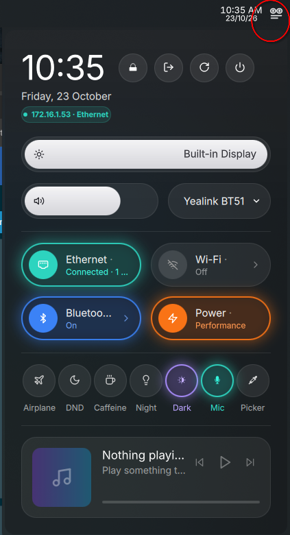

# OmniFlyout ⚡

<p align="center">
  
</p>

<p align="center">
  <strong>A modern, unified Quick Settings & Telemetry Flyout for KDE Plasma 6 (Wayland)</strong><br />
  <em>Created with precision by <strong>HearneLabs</strong></em>
</p>

<p align="center">
  
  
  
  
  
</p>

---

## ✨ Features

- 🌑 **Deep Obsidian Aesthetic**: Clean, dark acrylic styling (`rgba(18, 20, 29, 0.82)`) with native KWin background blur, subtle neon glowing borders, and smooth rounded corners.
- 🌐 **Physical IP Telemetry Badge**: Detects and displays your active physical IPv4 address (Ethernet or Wi-Fi), automatically filtering out Tailscale, Docker, virtual bridges (`virbr0`, `br-*`), and VPN tunnels.
- 📶 **Sliding Wi-Fi Sub-Page**:
  - Click the Wi-Fi pill to slide smoothly into a dedicated network manager.
  - Lists in-range networks with live signal strength and security indicators.
  - In-place password prompt for secured networks.
  - Quick rescan and master wireless radio toggle.
- 🎧 **Sliding Bluetooth Sub-Page**:
  - Click the Bluetooth pill to slide into your paired accessories manager.
  - Shows connected audio devices with battery percentages (`85% 🔋`) and device type icons (Headphones, Keyboards, Mice, Speakers).
  - One-tap connect and disconnect powered by native BlueZ.
  - Discovery scanning for nearby discoverable peripherals.
- 💡 **Focused Display Brightness**: Controls your built-in laptop screen with smooth throttling, eliminating external desktop monitor slider clutter.
- 🔊 **Audio Volume & Device Routing**:
  - Master volume slider with mute toggle.
  - In-place audio device picker to switch between Speakers, Bluetooth headsets, and microphones without opening System Settings.
- 🔋 **Power Profile Selector**:
  - Fast switching between Power Saver, Balanced, and Performance modes.
  - Interactive mouse wheel support on the power pill to cycle modes quickly.
- ⚡ **Neon Quick Toggles**:
  - **Airplane Mode**: Instant rfkill radio block.
  - **DND (Do Not Disturb)**: Silences Plasma notification popups in sync with Plasma's notification daemon.
  - **Caffeine**: Inhibits screen blanking and power sleep.
  - **Night Light**: Toggles blue light reduction.
  - **Dark Mode**: Instantly switches between dark and light color schemes.
  - **Mic Mute**: Hardware mute for default PipeWire input source.
  - **Color Picker**: Screen color sampler with history.
- 🎵 **Integrated Media Player**: Compact media card with album art, track/artist display, playback controls, and seekbar.
- 🎛️ **Isometric Cube Panel Icon**: Custom 3D isometric cube icon with interactive electric-cyan (`#38bdf8`) hover and active glow.

---

## 📋 Requirements

OmniFlyout runs natively on **KDE Plasma 6** using standard Linux system tools:

| Component | Minimum Version | Notes |
|---|---|---|
| **KDE Plasma** | 6.0+ | Supports Plasma 6.0, 6.1, 6.2, 6.3+ on Wayland and X11 |
| **NetworkManager** | Any (`nmcli`) | Used for Wi-Fi and Ethernet status |
| **BlueZ** | Any (`bluetoothctl`) | Used for Bluetooth device listing and pairing |
| **PipeWire / WirePlumber** | Any (`wpctl` or `pactl`) | Used for volume and audio device routing |
| **Power-Profiles-Daemon** | Any (`powerprofilesctl`) | Used for switching performance profiles |
| **Playerctl** *(Optional)* | Any | Used for MPRIS media playback and seekbar |

---

## 🚀 Installation

### Option 1: One-Command Installer (Recommended)

Clone the repository and run the installer script:

```bash
git clone https://github.com/brisbinchicken/omniflyout.git
cd omniflyout
./install.sh
```

### Option 2: Manual Installation via `kpackagetool6`

```bash
git clone https://github.com/brisbinchicken/omniflyout.git
cd omniflyout
chmod +x package/contents/scripts/*.sh
kpackagetool6 -t Plasma/Applet -i package
```

*(If upgrading an existing install, use `-u` instead of `-i`)*.

---

## 🖥️ Adding to Your Panel

1. Right-click any empty area on your KDE Plasma panel and choose **Add Widgets...** (or press `Meta + A`).
2. Search for **OmniFlyout**.
3. Drag the **OmniFlyout** widget onto your panel.
4. Click the **Isometric Cube** icon to launch your new control center!

---

## 🎮 Interaction & Controls

- **Left-Click on Left Icon Circle**: Instantly toggles the feature on or off (e.g. Wi-Fi on/off, Bluetooth on/off).
- **Left-Click on Pill Body or Chevron (`›`)**: Smoothly slides horizontally into the detailed sub-page (Wi-Fi or Bluetooth).
- **Left-Click `‹ Back`**: Slides smoothly back to the main flyout.
- **Mouse Wheel over Power Pill**: Cycles through Power Saver, Balanced, and Performance modes.
- **Right-Click on any Pill**: Launches the corresponding KDE System Settings module.

---

## 🗑️ Uninstallation

Run the included uninstaller script:

```bash
./uninstall.sh
```

Or manually:

```bash
kpackagetool6 -t Plasma/Applet -r org.hearnelabs.omniflyout
```

---

## 👨‍💻 Author & Credits

- **Author**: Created and designed by **HearneLabs**
- **License**: GNU General Public License v3.0 ([GPL-3.0](LICENSE))
- **Inspiration**: Special thanks to Agon A. (`ItsNotMeBro87`) for the initial shell integration script inspiration in Kontrol Center.
